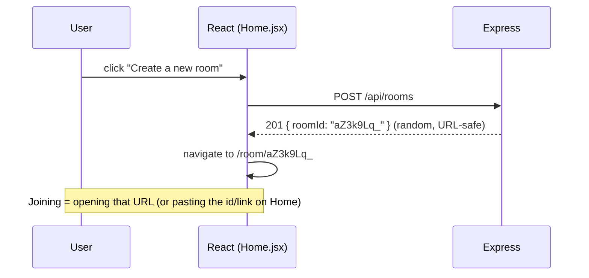
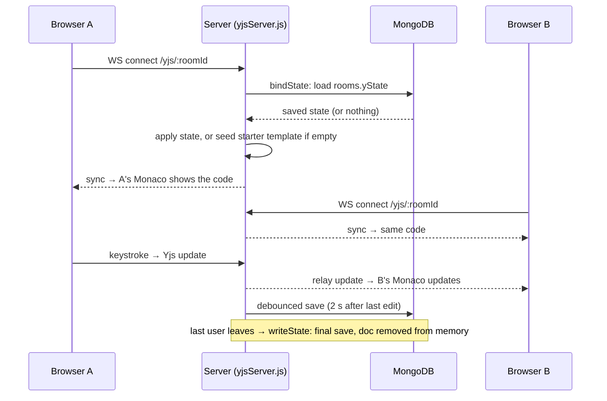
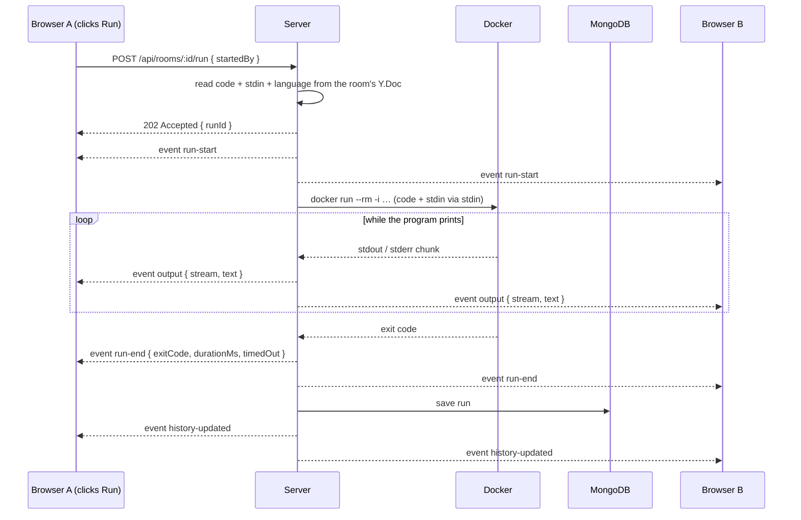

# CodeSync — Live Collaborative Code Editor & Sandboxed Runner

Two (or more) people open the **same room link**, edit code together in real time
(seeing each other's cursors and names), press **▶ Run**, and the code is executed in a
**brand-new, locked-down Docker container**. The output streams back **live to everyone
in the room**, and every run is saved to MongoDB.

| Layer          | Technology                                                    | Used for                              |
|----------------|---------------------------------------------------------------|---------------------------------------|
| Frontend       | **React 18** + **Vite 5**                                     | UI, routing, dev server (port 5180)   |
| Editor         | **Monaco Editor** (`@monaco-editor/react`, `monaco-editor`)   | The VS Code editor in the browser     |
| Real-time sync | **Yjs** (CRDT) + `y-websocket` + `y-monaco`                   | Shared code, language, live cursors   |
| Backend        | **Node.js** + **Express 4** + `ws`                            | REST API + WebSockets (port 4000)     |
| Database       | **MongoDB** + Mongoose                                        | Saved rooms + run history             |
| Execution      | **Docker** (`docker run` CLI)                                 | Sandboxed code execution              |

Languages: **JavaScript (Node 20)**, **Python 3.12**, **C++ (GCC 13)**, **Java 21**, **Go 1.22**,
**Rust 1.83**, **Ruby 3.3** — easy to add more.

---

## What is it for?

CodeSync lets people **write and run code together, in real time, from a browser** — with
nothing to install on their machines. Everyone in a room sees the same code, each other's
cursors, and the same live output.

| Use case | How CodeSync helps |
|---|---|
| **Pair programming** | Two developers edit the same file at once, see each other's cursors, and run it to check it works. |
| **Technical interviews** | The interviewer sends a room link and the candidate codes live. Both watch the program run, and History keeps every attempt. |
| **Teaching & tutoring** | Teacher and student share a room. The teacher fixes a line, the student runs it, and both see the output, including errors in red. |
| **Classroom labs / workshops** | Learners don't need to install Python, Node or a C++ compiler; Docker on the server provides them. |
| **Debugging help** | Paste broken code into a room, share the link, and someone else can edit and run it with you. |
| **Coding practice / contests** | Test solutions against input in the stdin box; time and memory limits behave like a judge. |
| **Trying untrusted snippets** | Code from the internet runs in an isolated container with no network or file access, so it can't harm your machine. |

### A typical session

1. Open **http://localhost:5180** and click **Create a new room**.
2. Click **Copy link** and send it to your partner. On another computer, use your machine's
   IP address instead of `localhost`.
3. Both of you type in the same editor; changes appear instantly for both of you.
4. Pick the language (JavaScript, Python, C++, Java, Go, Rust or Ruby) and press **▶ Run**.
5. The code runs in a fresh Docker container and the output streams into both screens.
6. Open **History** later to see every run with its code, result and output.

### What it is *not*

- **Not a full IDE.** It's one shared file per room, with no project folders, packages,
  debugger or Git.
- **Not for programs that need the internet or files.** The sandbox blocks network and disk
  on purpose.
- **Not for long programs.** Each run stops after 10 s and at 128 MB of memory (256 MB for
  Java, Go and Rust); both limits
  can be changed in `server/.env`.
- **Not ready for the public internet as-is.** There's no login, so anyone with a link can
  join and run code. Add authentication first (see [Security notes](#15-security-notes)).

---

## Table of contents

0. [What is it for?](#what-is-it-for)
1. [Quick start](#1-quick-start)
2. [Using the app](#2-using-the-app)
3. [Architecture](#3-architecture)
4. [Application flow, step by step](#4-application-flow-step-by-step)
5. [How each part works](#5-how-each-part-works)
6. [The Docker sandbox](#6-the-docker-sandbox)
7. [Data stored in MongoDB](#7-data-stored-in-mongodb)
8. [Project structure — what every file does](#8-project-structure--what-every-file-does)
9. [Configuration](#9-configuration)
10. [API reference](#10-api-reference)
11. [Adding a language](#11-adding-a-language)
12. [Production build & deployment](#12-production-build) — guides: **[Vercel](DEPLOY-VERCEL.md)** · **[Netlify](DEPLOY-NETLIFY.md)** · [overview](DEPLOYMENT.md)
13. [Testing & verifying](#13-testing--verifying)
14. [Troubleshooting](#14-troubleshooting)
15. [Security notes](#15-security-notes)

---

## 1. Quick start

### Prerequisites

| Tool        | Version | Check              | Notes                                                              |
|-------------|---------|--------------------|--------------------------------------------------------------------|
| Node.js     | ≥ 18    | `node -v`          |                                                                    |
| Docker      | any recent | `docker version` | Docker Desktop on Windows/macOS — must show a **Server** section (engine running), **Linux containers** mode |
| MongoDB     | ≥ 6     | —                  | Local install **or** `npm run db:up` (runs it in Docker). Optional — see below |

### Steps

```bash
# 1. Install all dependencies (root + server + client)
npm run install:all

# 2. Create the server config
cp server/.env.example server/.env
#   Windows PowerShell:  Copy-Item server\.env.example server\.env

# 3. Start MongoDB — skip if MongoDB is already running on localhost:27017
npm run db:up

# 4. Prepare the sandbox images once: pulls node:20-alpine, python:3.12-alpine, gcc:13,
#    eclipse-temurin:21-jdk-alpine, rust:1.83-alpine, ruby:3.3-alpine,
#    and BUILDS codesync-go:1.22 (≈ 2.8 GB in total; Rust alone is ~1.15 GB)
npm run pull-images

# 5. Start the backend (:4000) and the frontend (:5180) together
npm run dev
```

Open **http://localhost:5180**.

When the server starts, it prints its status — check that all three lines look healthy:

```
[docker] engine 29.x ready
[db] connected to mongodb://127.0.0.1:27017/codesync
[server] listening on http://localhost:4000
```

> **MongoDB is optional.** Without it, editing and running still work — rooms just aren't
> saved and the History tab stays empty. **Docker is required** for ▶ Run.

---

## 2. Using the app

1. **Home page** → click **Create a new room**. You land on `/room/<roomId>`.
2. Click **Copy link** in the header and send it to your partner (or open it in a second
   browser window). ⚠️ Do **not** click *Create a new room* in both windows — that makes two
   separate rooms.
3. Type together. Each person has a coloured cursor with their name. Click **your own
   avatar** (top right) to rename yourself.
4. Choose the language from the dropdown — it changes for everyone. If the editor still
   contains an untouched starter template, it is replaced with the new language's template.
5. Optionally type program input in the **stdin** box — it is **shared**: everyone in the
   room sees and edits the same input.
6. Press **▶ Run** (or **Ctrl + Enter**). Everyone in the room sees the output stream in:
   white = stdout, red = stderr, yellow = system messages (timeouts, limits, errors),
   light-blue italic = the stdin the program received (echoed at the top of every run).
7. The **History** tab lists past runs of the room; click one to see its saved output.

Header indicators:

| Indicator | Meaning |
|-----------|---------|
| `Live` (green) | Connected and fully synced with the server |
| `Syncing…` | Connected, receiving the document |
| `connecting` / `disconnected` (yellow) | No connection to the server — edits are kept locally and sent when it reconnects |
| `running · <name>` | Someone in the room is running code; Run is disabled until it ends |

### Giving input to your program (stdin)

The **stdin** box under the output panel is the input your program reads while it runs.
Anything typed there is fed to the program as if someone typed it on the keyboard in a
terminal.

**Why it exists:** in a normal terminal you answer `input()` / `std::cin` while the program
waits. Here the program runs inside a Docker container on the server with no keyboard
attached, so you **type the input before pressing Run** and it is handed to the program.

**Example (Python)**

```python
name = input()
age = int(input())
print(f"Hello {name}, next year you'll be {age + 1}")
```

stdin box:

```
Nirmal
24
```

Output:

```
Hello Nirmal, next year you'll be 25
```

Each line in the box is one line of input: the first `input()` gets `Nirmal`, the second
gets `24`.

**Reading stdin in each language**

| Language          | Read one line                                     | Read everything                          |
|-------------------|---------------------------------------------------|------------------------------------------|
| Python            | `input()`                                         | `sys.stdin.read()`                       |
| C++               | `std::getline(std::cin, s)` or `std::cin >> x`    | loop with `while (std::cin >> x)`        |
| JavaScript (Node) | —                                                 | `require('fs').readFileSync(0, 'utf8')`  |
| Java              | `new Scanner(System.in).nextLine()`               | loop with `scanner.hasNextLine()`        |
| Go                | `bufio.NewReader(os.Stdin).ReadString('\n')` or `fmt.Scan(&x)` | `io.ReadAll(os.Stdin)`      |
| Rust              | `io::stdin().read_line(&mut s)`                   | `io::stdin().read_to_string(&mut s)`     |
| Ruby              | `STDIN.gets` (or `gets`)                          | `STDIN.read`                             |

Node example — stdin `5` and `7` on separate lines prints `sum = 12`:

```js
const lines = require('fs').readFileSync(0, 'utf8').trim().split('\n');
const [a, b] = lines.map(Number);
console.log('sum =', a + b);
```

All starter templates (JavaScript, Python, C++, Java, Go, Rust, Ruby) read a name from stdin: type your name
in the box and press Run, and they print `Hello, <your name>!` instead of `Hello, world!`.

> ⚠️ **stdin is data, not code.** Typing `console.log("hi")` into the stdin box does not run
> it — it's just text that your program may read. If your code never reads stdin (no
> `input()`, `cin`, `readFileSync(0)`), whatever you type there is simply ignored. The label
> above the box shows the right call for the selected language.

**Why it's useful**

- **Test different inputs** without editing the code — change the box and press Run again.
- **Coding practice / interview problems** are usually "read input, print output", just like
  online judges.
- **Repeatable runs** — the stdin is saved with each run in **History**, so you can see exactly
  which input produced which output.

**Things to know**

- **Not interactive.** All input is sent at once when you press Run; you can't type more while
  the program is running.
- **Asking for more input than given** → the program gets "end of input": Python raises
  `EOFError`; C++ `std::cin` fails and leaves the variable empty / 0.
- **Empty box = no input** — fine for programs that don't read anything.
- **The input is echoed in the output panel.** Every run starts with a light-blue
  `stdin:` block showing exactly what the program received (`stdin: (empty)` if nothing).
  If you see your input there but the program's output doesn't use it, **your code isn't
  reading stdin** — e.g. a room created before the starter templates read stdin still has
  `console.log(greet('world'))`.
- **Shared, like the code.** The box (marked *SHARED*) is synced live between everyone in the
  room, kept for people who join later, and saved with the room. Whoever presses Run, the
  program gets the stdin everyone sees — the server reads it from the shared document, not
  from the person who clicked. Your text cursor stays in place while others type.
- **Limit:** 64 KB of input per run.

How it reaches the program internally is described in
[How the code gets into the container](#how-the-code-gets-into-the-container).

---

## 3. Architecture

```
  Browser A (localhost:5180)                         Browser B
 ┌──────────────────────────────┐                   ┌──────────────────────────────┐
 │  Monaco editor               │                   │  Monaco editor               │
 │      ⇅  MonacoBinding        │                   │      ⇅  MonacoBinding        │
 │  Y.Doc  ─ code (Y.Text)      │                   │  Y.Doc                       │
 │         ─ meta (Y.Map)       │                   │                              │
 │  Awareness (name, colour,    │                   │  Awareness                   │
 │             cursor)          │                   │                              │
 └──┬──────────┬──────────┬─────┘                   └──┬──────────┬──────────┬─────┘
    │ WS       │ WS       │ HTTP                       │          │          │
    │ /yjs/:id │ /events/ │ /api/*                     │          │          │
    │          │   :id    │      (Vite dev proxy → :4000)         │          │
 ┌──▼──────────▼──────────▼────────────────────────────▼──────────▼──────────▼─────┐
 │                       Node.js server — Express, port 4000                         │
 │                                                                                   │
 │  index.js ── routes WebSocket upgrades by path ──┬── /yjs/:id    → yjsServer.js   │
 │                                                  └── /events/:id → roomEvents.js  │
 │  routes/rooms.js     REST API                                                     │
 │  collab/yjsServer.js one in-memory Y.Doc per room · relays edits · saves to Mongo │
 │  collab/roomEvents.js broadcasts run-start / output / run-end to the room         │
 │  runner/runService.js one run at a time per room · saves result                  │
 │  runner/dockerRunner.js spawns `docker run …`, streams stdout/stderr              │
 │  runner/dockerCheck.js  finds the docker CLI, checks the engine at start-up       │
 └───────────┬───────────────────────────────────────────────┬───────────────────────┘
             │ Mongoose                                      │ docker CLI (child process)
     ┌───────▼────────┐                       ┌──────────────▼───────────────────────┐
     │   MongoDB      │                       │  Docker container  (one per run)      │
     │  rooms  runs   │                       │  no network · 128 MB · 0.5 CPU        │
     └────────────────┘                       │  read-only FS · user "nobody" · 10 s  │
                                              │  deleted when the program ends (--rm) │
                                              └───────────────────────────────────────┘
```

### Three channels between browser and server

| Channel                | Protocol  | Carries                                                    | Client code               | Server code              |
|------------------------|-----------|------------------------------------------------------------|---------------------------|--------------------------|
| `/yjs/<roomId>`        | WebSocket | Yjs sync messages (code + language) and awareness (cursors, names) | `hooks/useCollab.js`      | `collab/yjsServer.js`    |
| `/events/<roomId>`     | WebSocket | JSON run events: `status`, `run-start`, `output`, `run-end`, `history-updated` | `hooks/useRoomEvents.js`  | `collab/roomEvents.js`   |
| `/api/*`               | HTTP      | Create room, start a run, list/read history, health        | `lib/api.js`              | `routes/rooms.js`        |

**Why two WebSockets?** The Yjs channel syncs the *document* (things everyone edits).
The events channel carries *happenings* (a run started, output arrived) that are not part
of the document. Keeping them separate keeps the document small and the protocols simple.

In development, the browser only talks to **Vite on :5180**; `client/vite.config.js`
proxies `/api`, `/yjs` and `/events` to the Express server on **:4000**. In production,
Express serves everything on :4000 itself.

---

## 4. Application flow, step by step

### Flow A — Create / join a room



A room is "created" lazily: the id is just generated; the room's document comes into
existence the first time someone connects to it (Flow B).

### Flow B — Opening a room & live editing



In detail:

1. `Room.jsx` calls `useCollab(roomId, user)`, which creates a `Y.Doc` and a
   `WebsocketProvider` connected to `ws://<host>/yjs/<roomId>`. It also publishes
   `{ name, colour }` into **awareness**.
2. On the server, `index.js` sees the WebSocket upgrade for `/yjs/<roomId>` and hands it to
   y-websocket's `setupWSConnection`, which finds or creates the room's in-memory `Y.Doc`.
3. **First connection to a room:** `bindState` loads the saved binary state from
   MongoDB (`rooms.yState`). If the room is new, the **server** inserts the starter template
   — only the server seeds, so the template can never be inserted twice.
4. `CollabEditor.jsx` mounts Monaco, sets the model's line endings to `\n` (see the note
   below), and connects Monaco to `ydoc.getText('code')` with **`MonacoBinding`**.
5. **Typing:** Monaco change → MonacoBinding → `Y.Text` update → WebSocket → server →
   every other browser → their `Y.Text` → their Monaco. Yjs is a **CRDT**, so simultaneous
   edits merge automatically with no conflicts and no central locking.
6. **Cursors:** MonacoBinding writes your selection into awareness; other users' selections
   are drawn as decorations with CSS classes `yRemoteSelection-<clientId>`.
   `RemoteCursorStyles` generates one CSS rule per user so each cursor has its own colour
   and a name label.
7. **Language:** stored in `ydoc.getMap('meta').get('language')`, so changing it is just
   another synced edit.
8. **Saving:** the server saves the whole doc to MongoDB 2 s after the last change, and
   once more when the last user leaves (then frees the memory).

> **Line endings matter.** On Windows, Monaco defaults to `\r\n` (2 characters per line
> break) while Yjs counts `\n` (1 character). Without `model.setEOL(LF)` every edit on line
> *N* would land *N − 1* characters off for other users. Keep that line in `CollabEditor.jsx`.

### Flow C — Running code



In detail:

1. **Run** (or Ctrl+Enter) → `POST /api/rooms/<roomId>/run` with `{ startedBy }`.
   The request contains **neither the code nor the stdin**.
2. The server reads the code **and** the stdin **from its own copy of the shared Yjs
   document** — so what runs is exactly what everyone sees, whoever clicks Run.
   Checks: room exists, code not empty, code ≤ 100 KB, stdin ≤ 64 KB.
3. `runService.startRun` refuses if the room already has a run going (HTTP 409), records the
   run as active, and broadcasts `run-start` on `/events/<roomId>`.
4. `dockerRunner.runInDocker` spawns `docker run …` (see [section 6](#6-the-docker-sandbox)).
5. Each stdout/stderr chunk is broadcast immediately as `{ type: 'output', stream, text }`.
   `useRoomEvents` appends it to the output panel in every browser — this is the "live"
   part.
6. When the program exits (or is killed by a limit), the server broadcasts `run-end` with
   `exitCode`, `durationMs`, `timedOut`, `truncated`.
7. The run (code, stdin, who, output, result) is saved to MongoDB, then `history-updated`
   is broadcast so every History tab reloads.
8. Someone who joins **during** a run receives a `status` message on connect, so their Run
   button is disabled correctly.

---

## 5. How each part works

### Yjs in one paragraph
A `Y.Doc` is a shared data structure that lives in every browser *and* on the server.
Each change is encoded as a small binary *update*. Updates can be applied in any order
and always converge to the same result (that's what a CRDT guarantees). `y-websocket`
moves those updates over a WebSocket; `y-monaco` translates between Monaco edits and
`Y.Text` updates. **Awareness** is a separate, non-persistent channel for presence data
(name, colour, cursor) that disappears when a user disconnects.

### The shared document

| Key                                   | Type     | Content                           |
|---------------------------------------|----------|-----------------------------------|
| `ydoc.getText('code')`                | `Y.Text` | The source code in the editor     |
| `ydoc.getText('stdin')`               | `Y.Text` | The shared stdin box (bound to a `<textarea>` by `useSharedText`) |
| `ydoc.getMap('meta').get('language')` | `Y.Map`  | `javascript` / `python` / `cpp` / `java` / `go` / `rust` / `ruby` |
| awareness `user`                      | —        | `{ name, color }` for each person |
| awareness `selection`                 | —        | cursor / selection (set by y-monaco) |

### The user identity
`lib/user.js` makes a random name (e.g. `Otter-482`) and colour on first visit and stores
it in `localStorage`. There is no login — anyone with the room link can join.

### Why the server never needs the client to send code
Because the server holds the same `Y.Doc`, it can read the latest code itself. This also
means a modified client cannot run code that differs from what the others see.

---

## 6. The Docker sandbox

Every run starts a **fresh container** and deletes it afterwards. The actual command
(`server/src/runner/dockerRunner.js`):

```
docker run --rm -i --init
  --label codesync=run              tag, for filtering in Docker Desktop / CLI
  --name codesync-run-<uuid>
  --network none                    no internet, no LAN
  --memory 128m --memory-swap 128m  RAM cap, no swap
  --cpus 0.5                        half a CPU core
  --pids-limit 64                   stops fork bombs
  --read-only                       root filesystem is read-only…
  --tmpfs /tmp:rw,exec,nosuid,size=64m   …except a small /tmp in RAM
  --cap-drop ALL                    no Linux capabilities
  --security-opt no-new-privileges
  --user 65534:65534                runs as "nobody", not root
  --workdir /tmp
  <image>  sh -c "<script>"
```

### How the code gets into the container
No host folder is mounted. Everything goes through **stdin**:

```
line 1  : the source code, base64-encoded (base64 has no newlines)
rest    : whatever the user typed into the stdin box
```

The script inside the container:

```sh
IFS= read -r CODE_B64                                   # read line 1 only
printf '%s' "$CODE_B64" | base64 -d > /tmp/main.py      # decode into /tmp
exec timeout -s KILL 10 sh -c 'python3 -u /tmp/main.py' # run with a time limit
```

The program inherits the rest of stdin, so `input()`, `std::cin`, etc. read what the user
typed.

### Limits and how each one is enforced

| Limit          | Default   | Enforced by                                     | User sees                                         |
|----------------|-----------|-------------------------------------------------|---------------------------------------------------|
| Time           | 10 s      | `timeout` **inside** the container              | `[Time limit of 10s exceeded - process killed]`   |
| Memory         | 128 MB (Java, Go, Rust: 256 MB) | `--memory`, kernel OOM killer | `[Process killed - probably exceeded the 128m memory limit]` |
| Output         | 64 KB     | server counts bytes, then `docker rm -f`        | `[Output limit of 65536 bytes exceeded - process killed]` |
| Stuck container| 10 s + 30 s | server-side backstop timer, `docker rm -f`    | `[Sandbox did not finish in time - container removed]` |
| Network        | none      | `--network none`                                | connection errors in the program                  |

Design details worth knowing:
- **Why the time limit is inside the container:** Docker can take several seconds just to
  start a container (especially the first run after Docker Desktop starts). Counting that
  against the user's 10 s caused false time-outs.
- **Why `--init`:** without it, the user's program can end up as process 1 (PID 1) in the
  container, and Linux ignores kill signals sent to PID 1 from inside the container — so
  `timeout` could not stop an infinite loop. `--init` makes a tiny init process PID 1.
- **Why `docker rm -f` instead of `docker kill`:** it also removes a container that was
  created but never started.
- **Exit code 137** means "killed": the server reports it as a time-out if the time limit
  had passed, otherwise as probably out of memory.

### "I don't see the container in Docker Desktop"
That's expected. A container exists **only while the code runs** (often < 1 s) and is
deleted immediately (`--rm`). To watch one, open Docker Desktop → *Containers* and run
something slow:

```js
for (let i = 1; i <= 8; i++) { console.log('tick', i); await new Promise(r => setTimeout(r, 1000)); }
```

Or from a terminal during a run: `docker ps --filter label=codesync=run`.
To **keep** finished containers for inspection, set `RUN_KEEP_CONTAINERS=true` in
`server/.env` (debug only) and clean up later with
`docker container prune --filter label=codesync=run`.

---

## 7. Data stored in MongoDB

Database: `codesync` (from `MONGO_URI`).

### `rooms` collection — `server/src/models/Room.js`

| Field       | Type    | Meaning                                                    |
|-------------|---------|------------------------------------------------------------|
| `roomId`    | String  | unique, the id in the URL                                  |
| `language`  | String  | last selected language (for convenience)                   |
| `yState`    | Buffer  | the whole Yjs document, `Y.encodeStateAsUpdate(ydoc)`      |
| `createdAt` / `updatedAt` | Date | timestamps                                      |

Loading a room = `Y.applyUpdate(ydoc, yState)`. This is how code survives server restarts.

### `runs` collection — `server/src/models/Run.js`

| Field        | Type    | Meaning                                            |
|--------------|---------|----------------------------------------------------|
| `roomId`     | String  | room the run belongs to (indexed)                  |
| `language`   | String  |                                                    |
| `code`       | String  | the exact code that ran                            |
| `stdin`      | String  | input given                                        |
| `startedBy`  | String  | display name of who pressed Run                    |
| `output`     | Array   | `[{ stream: 'stdout'|'stderr'|'system', text }]` in order |
| `exitCode`   | Number  |                                                    |
| `timedOut`, `truncated` | Boolean |                                         |
| `durationMs` | Number  |                                                    |
| `createdAt`  | Date    |                                                    |

Inspect with `mongosh codesync` → `db.rooms.find()`, `db.runs.find().sort({createdAt:-1})`.

---

## 8. Project structure — what every file does

```
sandbox/
├── package.json              Root scripts: install:all, dev, build, start, db:up, pull-images
├── docker-compose.yml        MongoDB 7 for local development (npm run db:up)
├── netlify.toml              Netlify build settings for the frontend (base = client) + SPA redirect
├── README.md                 This file
├── DEPLOYMENT.md             Deployment overview: pick a guide, Vercel vs Netlify, single-VM option
├── DEPLOY-VERCEL.md          Step-by-step: Vercel frontend + VM backend + Atlas
├── DEPLOY-NETLIFY.md         Step-by-step: Netlify frontend + VM backend + Atlas
├── deploy/
│   ├── Caddyfile             HTTPS reverse proxy (incl. WebSockets) for the backend VM
│   └── codesync.service      systemd unit that keeps the backend running
│
├── server/                   ── BACKEND: Node + Express + Yjs + MongoDB + Docker
│   ├── package.json
│   ├── .env.example          Template for server/.env (all settings)
│   ├── scripts/
│   │   └── pullImages.js     Pulls every sandbox image in languages.js; BUILDS the ones
│   │                         with a `build` folder (Go)
│   ├── sandbox-images/
│   │   └── go/Dockerfile     golang:1.22-alpine + pre-compiled standard library
│   │                         (Go runs take ~1 s instead of ~25 s)
│   └── src/
│       ├── index.js          ENTRY. Express app, /api routes, WebSocket upgrade routing
│       │                     (/yjs → Yjs, /events → run events), serves client/dist in prod
│       ├── config.js         Every setting with defaults (port, Mongo URI, run limits)
│       ├── db.js             Mongo connection; isDbReady() lets the app run without Mongo
│       ├── models/
│       │   ├── Room.js       Saved Yjs document per room
│       │   └── Run.js        One saved run (code, output, result)
│       ├── routes/
│       │   └── rooms.js      REST API: languages, create room, run, history
│       ├── collab/
│       │   ├── yjsServer.js  y-websocket relay + MongoDB persistence + template seeding;
│       │   │                 getRoomSnapshot() gives the Run endpoint the current code
│       │   └── roomEvents.js Tiny pub/sub: join(room, ws), broadcast(room, msg)
│       └── runner/
│           ├── languages.js  Language table: image, file name, run command, template
│           ├── runService.js Run lifecycle: one-at-a-time lock, broadcasts, save to Mongo
│           ├── dockerRunner.js  Builds and spawns `docker run`, streams output, limits
│           └── dockerCheck.js   Finds `docker` (fixes PATH on Windows), checks engine
│
└── client/                   ── FRONTEND: React + Vite + Monaco + Yjs
    ├── package.json
    ├── index.html
    ├── vite.config.js        Port 5180 (strictPort); proxies /api, /yjs, /events → :4000
    ├── vercel.json           Vercel build settings + SPA rewrite (/room/<id> deep links)
    ├── .env.example          VITE_BACKEND_URL (only for split deployments)
    └── src/
        ├── main.jsx          ENTRY. Loads monacoSetup first, then renders <App/>
        ├── App.jsx           Routes: "/" → Home, "/room/:roomId" → Room
        ├── styles.css        Dark theme, layout, output colours
        ├── lib/
        │   ├── monacoSetup.js  Bundles Monaco + its web workers locally (no CDN) so the
        │   │                   editor and y-monaco share ONE Monaco instance
        │   ├── api.js          fetch helpers for /api, wsBase() for WebSocket URLs;
        │   │                   uses VITE_BACKEND_URL when the backend is on another domain
        │   └── user.js         Random name + colour, kept in localStorage
        ├── hooks/
        │   ├── useCollab.js      Y.Doc + WebsocketProvider + awareness; exposes status,
        │   │                     synced, language, setLanguage(), users
        │   ├── useSharedText.js  Binds a <textarea> to a Y.Text (the shared stdin box);
        │   │                     minimal-diff edits, keeps your caret during remote edits
        │   └── useRoomEvents.js  /events WebSocket → activeRun, output, result (auto-reconnect)
        ├── components/
        │   ├── CollabEditor.jsx  Monaco + LF line endings + MonacoBinding;
        │   │                     RemoteCursorStyles (per-user cursor colours + labels)
        │   ├── OutputPanel.jsx   Terminal-style output, auto-scroll, result line
        │   └── RunHistory.jsx    Past runs from MongoDB; click to load into Output
        └── pages/
            ├── Home.jsx          Create room / join by id or link
            └── Room.jsx          The editor screen: header, editor, output, history, stdin
```

Every source file starts with a comment block explaining its role.

### Where to look when you want to change…

| I want to change…                     | File                                          |
|---------------------------------------|-----------------------------------------------|
| Time / memory / CPU / output limits   | `server/.env` (or `server/src/config.js`)     |
| Supported languages, starter code     | `server/src/runner/languages.js`              |
| Docker flags                          | `server/src/runner/dockerRunner.js`           |
| What happens around a run             | `server/src/runner/runService.js`             |
| How rooms are saved/loaded            | `server/src/collab/yjsServer.js`              |
| Editor options (font, minimap, theme) | `client/src/components/CollabEditor.jsx`      |
| Layout / header / buttons             | `client/src/pages/Room.jsx`, `styles.css`     |
| Output colours                        | `client/src/styles.css` (`.stream-*`)         |

---

## 9. Configuration

`server/.env` (copy from `server/.env.example`):

| Variable               | Default                              | Meaning                                         |
|------------------------|--------------------------------------|-------------------------------------------------|
| `PORT`                 | `4000`                               | Express / WebSocket port                        |
| `MONGO_URI`            | `mongodb://127.0.0.1:27017/codesync` | MongoDB connection string                       |
| `CLIENT_ORIGIN`        | `http://localhost:5180`              | Frontend origin(s) allowed to use the API **and WebSockets** — comma-separated, `*` wildcard allowed (e.g. `https://app.vercel.app,https://app-*.vercel.app`). Other sites' WebSockets get 403 |
| `RUN_TIMEOUT_MS`       | `10000`                              | Max run time of the program                     |
| `RUN_MEMORY`           | `128m`                               | Container memory limit (a language's own `memory` in `languages.js` wins — Java/Go/Rust use `256m`) |
| `RUN_CPUS`             | `0.5`                                | Container CPU limit                             |
| `RUN_MAX_OUTPUT_BYTES` | `65536`                              | Output cap before the run is killed             |
| `RUN_KEEP_CONTAINERS`  | `false`                              | Debug: keep finished containers (no `--rm`)     |
| `DOCKER_BIN_DIR`       | *(auto)*                             | Folder containing `docker` if it's not on PATH  |

Restart the server after changing `.env` (nodemon only watches `src/`).

`client/.env` (copy from `client/.env.example`) — only for split deployments:

| Variable           | Default  | Meaning |
|--------------------|----------|---------|
| `VITE_BACKEND_URL` | *(empty)* | Backend's public URL, e.g. `https://api.yourdomain.com`. Empty = same origin (dev proxy / single server). Baked in at **build** time |

Ports: **5180** = Vite dev server (`client/vite.config.js`, `strictPort` — it refuses to start
rather than silently share a port), **4000** = backend.

---

## 10. API reference

### REST

| Method | Path                               | Body / result                                                         |
|--------|------------------------------------|-----------------------------------------------------------------------|
| GET    | `/api/health`                      | `{ ok, mongo: bool, docker: { cli, engine, version } }`               |
| GET    | `/api/languages`                   | `[{ id, label, template }]`                                           |
| POST   | `/api/rooms`                       | → `201 { roomId }`                                                    |
| GET    | `/api/rooms/:roomId`               | → `{ roomId, exists, language, online, activeRun }`                   |
| POST   | `/api/rooms/:roomId/run`           | `{ startedBy? }` → `202 { runId, startedBy, language, startedAt }` (code + stdin come from the shared doc); `409` if a run is active, `404` unknown room, `400` empty code, `413` too large |
| GET    | `/api/rooms/:roomId/runs`          | → last 20 runs (summary)                                              |
| GET    | `/api/rooms/:roomId/runs/:runId`   | → one run with full `output`                                          |

Room ids must match `^[A-Za-z0-9_-]{3,64}$`.

### WebSocket `/events/:roomId` (server → client, JSON)

| `type`            | Fields                                              | When                              |
|-------------------|-----------------------------------------------------|-----------------------------------|
| `status`          | `activeRun` (or `null`)                             | right after connecting             |
| `run-start`       | `runId, startedBy, language, startedAt`             | someone pressed Run               |
| `output`          | `runId, stream ('stdout'|'stderr'|'system'), text`  | each chunk of output              |
| `run-end`         | `runId, exitCode, timedOut, truncated, durationMs`  | program finished / killed         |
| `history-updated` | —                                                   | run saved to MongoDB              |

### WebSocket `/yjs/:roomId`
Standard y-websocket protocol (binary). Use `new WebsocketProvider('ws://host/yjs', roomId, ydoc)`.

---

## 11. Adding a language

Built in: JavaScript, Python, C++, Java, Go, Rust, Ruby. Example — adding **PHP**:

1. Add an entry to `server/src/runner/languages.js`:
   ```js
   php: {
     label: 'PHP 8.3',
     image: 'php:8.3-cli-alpine',
     // memory: '256m',        // optional: override RUN_MEMORY for this language
     // build: 'sandbox-images/php', // optional: build a custom image from a Dockerfile
     file: 'main.php',
     run: 'php /tmp/main.php',
     template: '<?php\n$name = trim(fgets(STDIN) ?: "") ?: "world";\necho "Hello, $name!\\n";\n',
   },
   ```
   Rules:
   - The image must contain `sh`, `base64` and `timeout` (all Alpine/Debian images do).
   - Avoid single quotes in `run` (it is wrapped in `sh -c '…'`).
   - The program runs as user `nobody` with a read-only filesystem: only `/tmp` is writable,
     and there is **no network** (so no package downloads at run time).
2. Add `php: 'php'` to `MONACO_LANG` in `client/src/components/CollabEditor.jsx` (syntax
   highlighting) and a hint to `STDIN_HINT` in `client/src/pages/Room.jsx`.
3. `npm run pull-images`, restart the server. The dropdown picks it up from `/api/languages`.

### How the compiled / JVM languages are set up (and why)

Measured in the real sandbox (0.5 CPU, read-only FS, no network), warm image:

| Language | Image | Notes |
|----------|-------|-------|
| Java 21  | `eclipse-temurin:21-jdk-alpine` | Runs `java Main.java` — the **single-file source launcher** compiles in memory, so no `javac` step and the class doesn't have to be named `Main`. JVM flags (`-XX:+UseSerialGC -XX:TieredStopAtLevel=1 -XX:-UsePerfData`) make start-up fast. Needs **256 MB** (at 128 MB a hello-world took ~7.5 s instead of ~1.9 s). |
| Go 1.22  | `codesync-go:1.22` (custom, built from `server/sandbox-images/go/Dockerfile`) | The official image doesn't include a compiled standard library, so every fresh container recompiled it (**~26 s** for hello-world). The custom image runs `go build std` once at build time → runs take **~1 s**. The cache is read-only at run time; it is only read. |
| Rust 1.83 | `rust:1.83-alpine` (~1.15 GB) | `rustc --edition 2021 -O` then runs the binary — **~1.5 s** for hello-world. `--edition 2021` because plain `rustc` defaults to the 2015 edition. **256 MB** gives the compiler headroom for bigger programs. No Cargo / crates (no network). |
| Ruby 3.3 | `ruby:3.3-alpine` | Interpreted, **~0.9 s**, default 128 MB is enough. Standard library only (no gem installs — no network). |

If a language's tool needs to *write* a cache, point it at `/tmp` (e.g. `HOME=/tmp`),
or pre-build the cache into a custom image as done for Go.

---

## 12. Production build

```bash
npm run build      # builds client/dist
npm start          # Express serves API + WebSockets + the built React app
```

Open **http://localhost:4000** — everything on one port. Put it behind a reverse proxy
(nginx, Caddy) with WebSocket upgrade enabled for `/yjs` and `/events` if you deploy it.

### Deploying to Vercel / Netlify

➡️ **Step-by-step guides: [DEPLOY-VERCEL.md](DEPLOY-VERCEL.md) · [DEPLOY-NETLIFY.md](DEPLOY-NETLIFY.md)**
(overview and single-server option: [DEPLOYMENT.md](DEPLOYMENT.md))

Short version: Vercel and Netlify can host **only the React frontend**. The backend needs
long-lived WebSockets and Docker, which they don't offer, so it runs on a Linux VM:

| Part     | Where                    | Key setting |
|----------|--------------------------|-------------|
| Frontend | Vercel (`client/vercel.json`, Root Directory `client`) or Netlify (`netlify.toml`) | `VITE_BACKEND_URL=https://api.yourdomain.com` (build time) |
| Backend  | Ubuntu VM + Docker + Caddy (HTTPS) + systemd (`deploy/`) | `CLIENT_ORIGIN=https://<your-frontend-domain>` |
| Database | MongoDB Atlas (free M0)  | `MONGO_URI=mongodb+srv://…` |

---

## 13. Testing & verifying

Quick checks:

```bash
curl http://localhost:4000/api/health
# {"ok":true,"mongo":true,"docker":{"cli":true,"engine":true,"version":"29.9.2"}}

docker ps --filter label=codesync=run      # during a run: the sandbox container
```

Manual end-to-end test:
1. Open http://localhost:5180 → *Create a new room* → *Copy link*.
2. Open the link in a second window (or a private window, to get a different user).
3. Type on **several different lines** in both windows — text must appear in exactly the same
   place in both.
4. Press Run in one window — output must appear in both.
5. Try the limits: `while(true){}` (time-out after 10 s), a 500 MB allocation (memory),
   `while(true) console.log('x'.repeat(1000))` (output cap), an HTTP request (blocked).

These behaviours were verified during development: all seven languages, stdin, compile errors,
stderr + exit codes, non-root user, no network, read-only FS, time / memory / output limits,
live streaming, history saved, no leftover containers, and two real browser windows editing
on multiple lines staying identical.

---

## 14. Troubleshooting

| Symptom | Cause / fix |
|---------|-------------|
| Page shows a different app / no *Create a new room* button | Another project's dev server is on the same port. CodeSync uses **5180**; open http://localhost:5180 |
| Output: *Docker CLI not found* | Docker not installed, or not on PATH. The server also looks in `C:\Program Files\Docker\Docker\resources\bin`; otherwise set `DOCKER_BIN_DIR`. Check `GET /api/health` |
| Server log: *engine is not running* | Start Docker Desktop and wait for "Engine running" |
| First run of a language is slow | Image is downloading — run `npm run pull-images` once |
| Go: `pull access denied for codesync-go` | The Go image is custom and must be **built**, not downloaded: `npm run pull-images`. The server log warns at start-up about any missing image |
| Go takes ~25 s / times out | You're using plain `golang:*` instead of `codesync-go:1.22` — see section 11 |
| No container visible in Docker Desktop | Normal — see [section 6](#i-dont-see-the-container-in-docker-desktop) |
| Two windows don't see each other's edits | They must open the **same room URL**. *Create a new room* in each window makes two rooms |
| Edits land in the wrong place for the other user | Line-ending mismatch; `CollabEditor.jsx` must call `model.setEOL(LF)` before creating `MonacoBinding`. Refresh both windows after updating |
| Typed stdin but output ignores it | Check the light-blue `stdin:` block at the top of the output: if your input is there, the program received it but your **code doesn't read it** (see [stdin](#giving-input-to-your-program-stdin)) |
| Header shows `disconnected` | Server on :4000 not running, or a proxy blocks WebSockets |
| `[db] could not connect to MongoDB` | Start Mongo (`npm run db:up`) or fix `MONGO_URI`. App works without saving |
| History tab empty | MongoDB not connected (check `/api/health` → `mongo`) |
| *A run is already in progress* | One run per room at a time — wait (max ~10 s) |
| `exec format error` | Docker Desktop must use **Linux containers** |
| Vite: *Port 5180 is already in use* | Something else uses 5180 — stop it or change `port` in `client/vite.config.js` (and `CLIENT_ORIGIN`) |

---

## 15. Security notes

The sandbox is reasonably locked down for a **local / internal** tool, but plain Docker is
not a perfect security boundary, and anyone with a room link can run code. Before exposing
it to the internet:

- Add **authentication** and **rate limiting** (per user and per room).
- Run containers under **gVisor** (`--runtime=runsc`) or Kata Containers / Firecracker.
- Run the backend on a dedicated machine/VM: access to the Docker socket is effectively root
  on the host.
- Serve over **HTTPS/WSS** (the client already switches to `wss://` on HTTPS pages).
- Keep `RUN_KEEP_CONTAINERS=false`.
